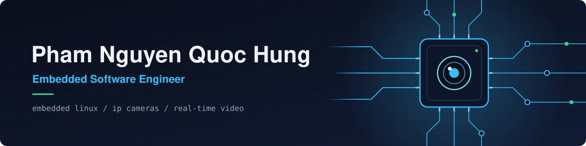

### Hi, I'm Hung

Embedded software engineer in Ho Chi Minh City.

I mostly write C/C++ for Embedded Linux boards and MCUs (STM32, FreeRTOS). Day to day that means IP camera firmware, video streaming (WebRTC, RTSP, ONVIF, lately MoQ) and getting devices behind NAT to talk to each other.

Before cameras I did IoT: sensor nodes, gateways, Modbus/CAN, MQTT over 4G. Hundreds of those devices are deployed and still running in the field.

Most of what I build isn't public, but some side projects and tools end up here:

- [udp-hole-punching](https://github.com/hunqp/udp-hole-punching) - P2P between two devices behind NAT, STUN + MQTT for signaling
- [IPVidex](https://github.com/hunqp/IPVidex) - desktop tool for finding and debugging ONVIF/RTSP cameras
- [moq-viewer](https://github.com/hunqp/moq-viewer) - Android viewer for camera streams over Media over QUIC

Contact: [LinkedIn](https://www.linkedin.com/in/hungpnq) or hunqp.work@gmail.com
